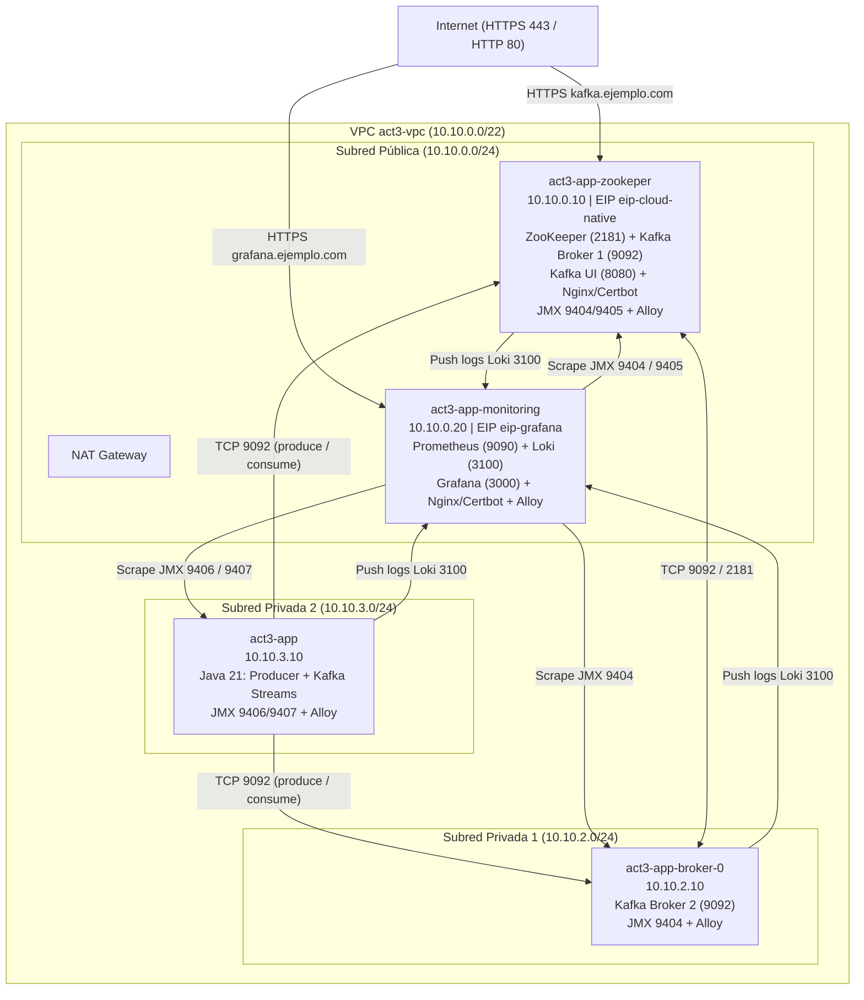

# Plataforma Cloud-Native de Procesamiento de Ventas con Apache Kafka

Sistema distribuido de ingesta, validación, deduplicación y agregación de eventos de ventas en tiempo real sobre **Apache Kafka** y **Kafka Streams (Java 21)**, provisionado en **AWS** con **Terraform**, desplegado de forma automatizada sin SSH (**S3 + AWS SSM**) y monitoreado con **Prometheus, Loki, Grafana y Grafana Alloy**.

---

## Tabla de contenidos

1. [Arquitectura general](#arquitectura-general)
2. [Estructura del repositorio](#estructura-del-repositorio)
3. [Prerrequisitos](#prerrequisitos)
4. [Configuración inicial (`.env.example` y `.tfvars.example`)](#configuración-inicial-envexample-y-tfvarsexample)
5. [Ejecución local y pruebas automáticas](#ejecución-local-y-pruebas-automáticas)
6. [Despliegue completo en AWS](#despliegue-completo-en-aws)
7. [Pipeline de ventas y escenario de demostración](#pipeline-de-ventas-y-escenario-de-demostración)
8. [Observabilidad y métricas](#observabilidad-y-métricas)
9. [Tolerancia a fallos y límites](#tolerancia-a-fallos-y-límites)
10. [Limpieza de recursos y seguridad](#limpieza-de-recursos-y-seguridad)

---

## Arquitectura general

La infraestructura se despliega en una VPC dedicada (`10.10.0.0/22`) con **1 subred pública** (`10.10.0.0/24`) y **2 subredes privadas** (`10.10.2.0/24`, `10.10.3.0/24`) distribuidas en 2 zonas de disponibilidad, con salida a internet para las instancias privadas mediante **NAT Gateway**. Ninguna instancia expone SSH: toda administración y despliegue se realiza vía **AWS Systems Manager (SSM)**.



### Inventario de nodos y red

| Instancia EC2 (`tag:Name`) | Subred | IP privada fija | Acceso público | Security Group | Servicios y puertos internos |
|---|---|---|---|---|---|
| `act3-app-zookeper` | Pública (`10.10.0.0/24`) | `10.10.0.10` | EIP `eip-cloud-native` (80, 443, 8080) | `act3-sg-kafka` | ZooKeeper (`2181`), Kafka Broker 1 (`9092`), Kafka UI (`8080` vía Nginx), JMX (`9404`, `9405`), Alloy |
| `act3-app-broker-0` | Privada 1 (`10.10.2.0/24`) | `10.10.2.10` | Solo salida vía NAT | `act3-sg-kafka` | Kafka Broker 2 (`9092`), JMX (`9404`), Alloy |
| `act3-app` | Privada 2 (`10.10.3.0/24`) | `10.10.3.10` | Solo salida vía NAT | `act3-sg-app` | `init-topics`, Kafka Streams (`consumer`, JMX `9407`), `producer` (JMX `9406`), `scenario`, Alloy |
| `act3-app-monitoring` | Pública (`10.10.0.0/24`) | `10.10.0.20` | EIP `eip-grafana` (80, 443) | `act3-sg-monitoring` | Prometheus (`127.0.0.1:9090`), Loki (`10.10.0.20:3100`), Grafana (`127.0.0.1:3000` vía Nginx), Alloy |

---

## Estructura del repositorio

```text
.
├── .env.example                       # Plantilla para Kafka local (docker-compose.yml raíz)
├── .gitignore                         # Exclusiones de secretos, estado Terraform, builds y dependencias
├── docker-compose.yml                 # Clúster Kafka local (ZooKeeper + 2 brokers) para desarrollo
├── COMANDOS-DEMOSTRACION.md           # Guía rápida de comandos de validación y pruebas en vivo
├── app/                               # Aplicación Java 21 (Maven + Kafka Streams + Producer + Tests)
│   ├── .env.example                   # Plantilla de configuración de tópicos, ventanas y productor
│   ├── Dockerfile                     # Build multi-stage (Maven + Temurin 21 + JMX Prometheus agent)
│   ├── docker-compose.yml             # Servicios init-topics, consumer, producer y perfil scenario
│   ├── jmx/app.yml                    # Reglas de exportación JMX (métricas Kafka Streams y negocio)
│   ├── src/                           # Código fuente Java y tests unitarios/de topología
│   └── README.md                      # Documentación técnica detallada de la topología y reglas de negocio
├── ec2/                               # Compose y configuración por nodo Kafka en AWS
│   ├── app-1/                         # ZooKeeper + Broker 1 + Kafka UI (act3-app-zookeper)
│   │   ├── .env.example
│   │   └── docker-compose.yml
│   └── app-2/                         # Broker 2 (act3-app-broker-0)
│       ├── .env.example
│       └── docker-compose.yml
├── monitoring/                        # Stack de observabilidad
│   ├── alloy/config.alloy             # Recolección de logs Docker hacia Loki
│   ├── grafana/provisioning/          # Datasources (Prometheus, Loki) y dashboard EA3 pre-cargado
│   ├── jmx/                           # Reglas JMX para brokers Kafka y ZooKeeper
│   ├── alloy.env.example              # Plantilla de referencia para Grafana Alloy
│   ├── monitoring.env.example         # Plantilla para Prometheus, Loki y Grafana
│   ├── docker-compose.alloy.yaml      # Compose de Grafana Alloy (se despliega en los 4 nodos)
│   ├── docker-compose.monitoring.yaml # Compose de Prometheus + Loki + Grafana
│   ├── loki.yaml                      # Configuración TSDB y retención (7 días) de Loki
│   ├── prometheus.yml                 # Scrape configs parametrizados por IP privada
│   └── prometheus-entrypoint.sh       # Sustitución de variables de entorno al iniciar Prometheus
├── scripts/                           # Automatización de despliegue vía AWS SDK (S3 + SSM)
│   ├── .env.example                   # Plantilla de bucket S3, credenciales AWS y dominios
│   ├── package.json                   # Scripts npm (deploy-kafka, deploy-app, deploy-monitoring, configure-nginx)
│   ├── deploy-kafka.js                # Despliega ec2/app-1 y ec2/app-2 + JMX agent vía S3 + SSM
│   ├── deploy-app.js                  # Sincroniza app/, compila imagen Docker y levanta servicios en act3-app
│   ├── deploy-monitoring.js           # Despliega Prometheus/Loki/Grafana y Alloy en los 4 nodos
│   ├── configure-nginx.js             # Configura Nginx reverse proxy + HTTPS Certbot en Kafka UI y Grafana
│   └── ec2/                           # Scripts de demostración que se ejecutan DENTRO de las EC2 (no en local)
│       ├── demo-duplicados.sh         # Deduplicación por eventId vs. idempotencia del producer, con crash del consumer
│       └── demo-tolerancia-fallos.sh  # Caída y recuperación de un broker con consumer escalado a 2 (vía SSM)
└── terraform/                         # Infraestructura como Código (AWS VPC, SG, EC2, EIP) en 2 entornos
    ├── environments/
    │   ├── lab/                       # AWS Academy Learner Lab (LabInstanceProfile, credenciales de sesión)
    │   │   ├── main.tf                # Orquestación de módulos y data sources (AMI Ubuntu, EIPs, IAM profile del lab)
    │   │   ├── variables.tf           # Variables de red, cómputo y EIPs
    │   │   ├── output.tf              # Outputs de VPC, instancias, IPs y comandos SSM
    │   │   └── terraform.tfvars.example
    │   └── prod/                      # Cuenta AWS real (reutiliza un instance profile creado a mano)
    │       ├── main.tf
    │       ├── variables.tf           # Incluye instance_profile_name (por defecto EC2-SSM-ROLE)
    │       ├── output.tf
    │       └── terraform.tfvars.example
    ├── modules/                       # Módulos compartidos: network, security, compute (+ iam, solo prod)
    └── resources/                     # Scripts user_data (Docker, AWS CLI v2, SSM, Nginx + Certbot)
```

---

## Prerrequisitos

### Herramientas locales
- **Docker** y **Docker Compose v2** (`docker compose`)
- **Terraform >= 1.5**
- **Node.js >= 20.12** (los scripts usan `process.loadEnvFile` nativo de Node)
- **AWS CLI v2** y **Session Manager Plugin** (para abrir sesiones SSM con las EC2 si se requiere inspección manual)

### Recursos previos en AWS (para despliegue en la nube)
- Cuenta AWS, según el entorno de Terraform:
  - **`lab`**: **AWS Academy Learner Lab**, reutilizando `LabInstanceProfile` (no se pueden crear roles IAM).
  - **`prod`**: cuenta AWS real con credenciales propias (`AWS_ACCESS_KEY_ID` / `AWS_SECRET_ACCESS_KEY`); Terraform **no** gestiona IAM: el rol y su instance profile (`EC2-SSM-ROLE` por defecto, con `AmazonSSMManagedInstanceCore` + lectura del bucket S3 de despliegue) se crean a mano y Terraform solo los referencia.
- **2 Elastic IPs creadas manualmente** en la misma región (`us-east-1` por defecto):
  - Tag `Name = eip-cloud-native` (se asociará automáticamente a `act3-app-zookeper`).
  - Tag `Name = eip-grafana` (se asociará automáticamente a `act3-app-monitoring`).
- **1 Bucket S3 privado** para staging temporal de archivos durante el despliegue (los scripts borran automáticamente los objetos subidos al finalizar).
- **2 registros DNS tipo `A`** apuntando a las respectivas Elastic IPs (por ejemplo `kafka.ejemplo.com` y `grafana.ejemplo.com`), necesarios para emitir los certificados TLS con Let's Encrypt.

---

## Configuración inicial (`.env.example` y `.tfvars.example`)

Ningún archivo `.env` real ni `terraform.tfvars` está versionado en Git. Todas las plantillas `*.example` incluyen **valores inventados o de referencia** que debes copiar y ajustar antes de ejecutar o desplegar.

| Plantilla | Archivo destino | Variables críticas a revisar / reemplazar |
|---|---|---|
| [`.env.example`](./.env.example) | `.env` | Solo necesario para levantar el Kafka local (`docker-compose.yml` raíz). |
| [`app/.env.example`](./app/.env.example) | `app/.env` | `KAFKA_BOOTSTRAP`, `WINDOW_SECONDS`, `WINDOW_GRACE_SECONDS`, `INVALID_RATE`. |
| [`ec2/app-1/.env.example`](./ec2/app-1/.env.example) | `ec2/app-1/.env` | **`KAFKA_UI_PASSWORD`** (reemplazar `reemplazar-con-clave-segura` antes de desplegar). |
| [`ec2/app-2/.env.example`](./ec2/app-2/.env.example) | `ec2/app-2/.env` | IPs privadas (`PRIVATE_IP`, `ZOOKEEPER_IP`) si cambias el CIDR de la VPC. |
| [`scripts/.env.example`](./scripts/.env.example) | `scripts/.env` | **`S3_BUCKET`**, **`CERTBOT_EMAIL`**, **`KAFKA_DOMAIN`**, **`GRAFANA_DOMAIN`**, credenciales AWS (`AWS_ACCESS_KEY_ID`, `AWS_SECRET_ACCESS_KEY`, `AWS_SESSION_TOKEN`). |
| [`monitoring/monitoring.env.example`](./monitoring/monitoring.env.example) | `monitoring/monitoring.env` | **`GRAFANA_ADMIN_PASSWORD`** (no puede comenzar con `replace-with`) y **`GRAFANA_DOMAIN`**. |
| [`monitoring/alloy.env.example`](./monitoring/alloy.env.example) | `monitoring/alloy.env` | Opcional: `deploy-monitoring.js` genera automáticamente `alloy.env` en cada EC2. |
| [`terraform/environments/lab/terraform.tfvars.example`](./terraform/environments/lab/terraform.tfvars.example) | `terraform/environments/lab/terraform.tfvars` | **`eip_public_ip`** y **`eip_grafana_public_ip`** con las IPs reales de tus Elastic IPs. |
| [`terraform/environments/prod/terraform.tfvars.example`](./terraform/environments/prod/terraform.tfvars.example) | `terraform/environments/prod/terraform.tfvars` | **`eip_public_ip`** y **`eip_grafana_public_ip`** de la cuenta real. |

### Copia rápida de plantillas

**Linux / macOS / Git Bash:**
```bash
cp .env.example .env
cp app/.env.example app/.env
cp ec2/app-1/.env.example ec2/app-1/.env
cp ec2/app-2/.env.example ec2/app-2/.env
cp scripts/.env.example scripts/.env
cp monitoring/monitoring.env.example monitoring/monitoring.env
cp terraform/environments/lab/terraform.tfvars.example terraform/environments/lab/terraform.tfvars
cp terraform/environments/prod/terraform.tfvars.example terraform/environments/prod/terraform.tfvars
```

**PowerShell (Windows):**
```powershell
Copy-Item .env.example .env
Copy-Item app/.env.example app/.env
Copy-Item ec2/app-1/.env.example ec2/app-1/.env
Copy-Item ec2/app-2/.env.example ec2/app-2/.env
Copy-Item scripts/.env.example scripts/.env
Copy-Item monitoring/monitoring.env.example monitoring/monitoring.env
Copy-Item terraform/environments/lab/terraform.tfvars.example terraform/environments/lab/terraform.tfvars
Copy-Item terraform/environments/prod/terraform.tfvars.example terraform/environments/prod/terraform.tfvars
```

> **Recomendación de seguridad:** Para `AWS_ACCESS_KEY_ID`, `AWS_SECRET_ACCESS_KEY` y `AWS_SESSION_TOKEN` (especialmente en AWS Learner Lab, donde rotan en cada sesión), es preferible exportarlos en tu terminal. Todos los scripts en `scripts/` priorizan las variables de la shell por sobre `scripts/.env`.

---

## Ejecución local y pruebas automáticas

### 1. Levantar clúster Kafka local (ZooKeeper + 2 brokers)
```bash
cp .env.example .env
docker compose up -d
docker compose ps
```
Los brokers quedan accesibles desde el host en `localhost:9092` y `localhost:9093`.

### 2. Ejecutar tests unitarios y de topología de Kafka Streams
No requiere tener Java ni Maven instalados localmente (se ejecuta en contenedor):

```bash
cd app
docker run --rm -v "$PWD:/src" -w /src maven:3.9-eclipse-temurin-21 mvn -B test
```

En PowerShell:
```powershell
cd app
docker run --rm -v "${PWD}:/src" -w /src maven:3.9-eclipse-temurin-21 mvn -B test
```

La suite (`SaleValidatorTest`, `StreamsTopologyTest`, `BusinessMetricsTest`) valida cada código de rechazo hacia DLQ, ventanas tumbling por `eventTime`, deduplicación por `eventId`, eventos tardíos dentro/fuera de gracia y contadores de negocio.

---

## Despliegue completo en AWS

Ejecutar los pasos en el siguiente orden desde la raíz del repositorio:

### Paso 1. Exportar credenciales AWS y provisionar infraestructura (Terraform)
Elige el entorno (`lab` para AWS Academy, `prod` para la cuenta AWS real), completa su `terraform.tfvars` con las IPs reales de `eip-cloud-native` y `eip-grafana` y ejecuta desde el directorio del entorno:

```bash
cd terraform/environments/lab   # o terraform/environments/prod
terraform init
terraform plan
terraform apply
```

Espera ~2 minutos después de `terraform apply` para que el `user_data` de las EC2 termine de instalar Docker, AWS CLI v2, SSM Agent y Nginx/Certbot. Puedes consultar las IPs y comandos SSM con:

```bash
terraform output
```

### Paso 2. Instalar dependencias de los scripts de despliegue
```bash
cd ../../../scripts
npm ci
```

### Paso 3. Desplegar el clúster Kafka (ZooKeeper + 2 brokers + Kafka UI)
Asegúrate de haber configurado `scripts/.env`, `ec2/app-1/.env` (con una `KAFKA_UI_PASSWORD` segura) y `ec2/app-2/.env`:

```bash
npm run deploy-kafka
```

### Paso 4. Desplegar la aplicación de ventas (Kafka Streams + Producer)
Verifica `app/.env` y ejecuta:

```bash
npm run deploy-app
```

Esto sube `app/` a S3, sincroniza `/opt/ventas` en `act3-app`, compila la imagen `ventas-app:latest`, crea los tópicos (`ventas-raw`, `ventas-agregadas`, `ventas-raw-dlq`) e inicia `consumer` y `producer`. Además copia a `/opt/ventas` los scripts de [`scripts/ec2/`](./scripts/ec2/) con permiso de ejecución (solo los copia; se corren a mano, ver [Scripts de demostración](#scripts-de-demostración-en-las-ec2)).

### Paso 5. Desplegar observabilidad (Prometheus + Loki + Grafana + Alloy)
Verifica `monitoring/monitoring.env` (contraseña segura y dominio) y ejecuta:

```bash
npm run deploy-monitoring
```

Esto levanta Prometheus, Loki y Grafana en `act3-app-monitoring` y despliega **Grafana Alloy** en los 4 nodos para centralizar logs de contenedores en Loki.

### Paso 6. Configurar Nginx + HTTPS (Let's Encrypt)
Verifica que los registros DNS `A` de `KAFKA_DOMAIN` y `GRAFANA_DOMAIN` ya apunten a las Elastic IPs correspondientes y ejecuta:

```bash
npm run configure-nginx
```

Al finalizar, **Kafka UI** y **Grafana** quedarán accesibles únicamente por HTTPS con redirección automática desde HTTP. También puedes configurar un solo destino con `node configure-nginx.js kafka` o `node configure-nginx.js grafana`.

---

## Pipeline de ventas y escenario de demostración

La aplicación en [`app/`](./app/) implementa un flujo de procesamiento en tiempo real documentado en detalle en [`app/README.md`](./app/README.md):

```text
ventas-raw ──► SaleValidator ──(inválido)──► ventas-raw-dlq
                    │
                    ▼ (rekey por tienda + repartition)
          DedupLateProcessor
            ├── tardío fuera de gracia ──► ventas-raw-dlq (EVENTO_TARDIO) + log + métrica
            └── eventId duplicado ───────► ventas-raw-dlq (EVENT_ID_DUPLICADO)
                    │
                    ▼
   Ventana tumbling 60 s (gracia 30 s) + suppress(untilWindowCloses) ──► ventas-agregadas
```

Para validar en vivo el clúster (ISR, failover de broker, inspección de tópicos, DLQ y corrida del escenario determinista `ScenarioProducer` con `docker compose --profile scenario run --rm scenario`, o `one-each` (un inválido, un duplicado y un tardío) y los modos `invalid`, `duplicate` y `late` con `docker compose exec -T -e JAVA_TOOL_OPTIONS= consumer java -cp /app/app.jar cl.duoc.ventas.ScenarioProducer <modo>`), consulta la guía paso a paso en [`COMANDOS-DEMOSTRACION.md`](./COMANDOS-DEMOSTRACION.md).

### Scripts de demostración en las EC2

Los scripts de [`scripts/ec2/`](./scripts/ec2/) automatizan las demos con verificaciones (`OK` / `FALLO`) y terminan con código distinto de 0 si alguna falla. `npm run deploy-app` los deja en `/opt/ventas` de `act3-app`; se ejecutan desde una sesión de Session Manager (no desde la máquina local). Ambos aceptan `--pausa` (Enter entre pasos, para narrar en vivo) y `--evidencia DIR` (guarda la salida de cada paso), y `-h` muestra la ayuda.

| Script | Qué demuestra | Uso |
|---|---|---|
| `demo-duplicados.sh` | Un mismo `eventId` enviado dos veces entra dos veces a `ventas-raw` (la idempotencia del producer no lo evita) y el consumer lo descarta a la DLQ como `EVENT_ID_DUPLICADO`; tras un `kill -9` del consumer el estado de deduplicación se restaura desde el changelog. | `sudo bash /opt/ventas/demo-duplicados.sh [--sin-crash]` |
| `demo-tolerancia-fallos.sh` | Escala el consumer a 2, detiene `kafka-2` y verifica failover de líderes, ISR reducido, pipeline vivo y recuperación del ISR de 2 brokers. Envía cada comando docker por SSM a la EC2 correspondiente (el instance profile necesita SSM y `ec2:DescribeInstances`). | `sudo bash /opt/ventas/demo-tolerancia-fallos.sh [--fallo contenedor\|daemon] [--espera SEG] [--no-recuperar]` |

`demo-duplicados.sh` escribe eventos de prueba en `ventas-raw` y `ventas-raw-dlq` y reinicia el consumer (los contadores de `BusinessMetrics` vuelven a 0). `demo-tolerancia-fallos.sh` deja el consumer escalado a 2 réplicas y, con `--no-recuperar`, el broker 2 caído (el script imprime cómo recuperarlo).

---

## Observabilidad y métricas

| Componente | Puerto / Endpoint | Destino / Uso |
|---|---|---|
| Kafka Broker 1 y 2 (`jmx_prometheus_javaagent`) | `9404/metrics` | Scrapeado por Prometheus (`job="kafka-brokers"`) |
| ZooKeeper (`jmx_prometheus_javaagent`) | `9405/metrics` | Scrapeado por Prometheus (`job="zookeeper"`) |
| App Producer (`jmx_prometheus_javaagent`) | `9406/metrics` | Scrapeado por Prometheus (`job="ventas-app"`, `node="app-producer"`) |
| App Kafka Streams (`jmx_prometheus_javaagent`) | `9407/metrics` | Scrapeado por Prometheus (`job="ventas-app"`, `node="app-streams"`) + métricas de negocio `ventas_*_total` |
| 2ª réplica de Kafka Streams (`docker compose up -d --scale consumer=2`) | `9408/metrics` | Scrapeado por Prometheus (`job="ventas-app-escala"`, `node="app-streams"`); queda `DOWN` mientras haya una sola réplica y no resta a "Procesos de la app disponibles". Requiere la regla de Security Group `app_metrics_9408` (Terraform) |
| `node_exporter` (en los 4 nodos, desplegado junto a Alloy) | `9100/metrics` (solo desde `sg-monitoring`) | Scrapeado por Prometheus (`job="node-exporter"`, `node=zookeper\|broker-0\|app\|monitoring`): CPU, RAM y disco de cada EC2 |
| Grafana Alloy (en los 4 nodos) | Push hacia `10.10.0.20:3100` | Centralización de logs Docker en Loki con etiquetas `node`, `container` y `service` |

### Métricas de negocio expuestas por `BusinessMetrics` (puerto `9407`)
- `ventas_procesadas_total`: ventas válidas agregadas en ventana.
- `ventas_enviadas_dlq_total`: total de registros derivados a la DLQ (inválidas + duplicadas + tardías).
- `ventas_invalidas_total`: rechazadas por validación de esquema/reglas.
- `ventas_duplicadas_total`: `eventId` repetidos detectados en el `WindowStore`.
- `ventas_tardias_total`: eventos válidos llegados fuera del período de gracia (no se agregan y van a la DLQ como `EVENTO_TARDIO`).

Son contadores en memoria (se reinician con el contenedor). Con 2 réplicas del consumer, cada una cuenta solo lo que procesó y los paneles de Grafana las suman con `sum()`.

### Dashboard de Grafana
Al ingresar a `https://<GRAFANA_DOMAIN>` (usuario `admin`, contraseña definida en `monitoring/monitoring.env`), encontrarás pre-provisionado el dashboard:
- Carpeta **Ventas Lab** → **"EA3 - Observabilidad integral Kafka y ventas"**.
- Carpeta **Ventas Lab** → **"Infraestructura EC2"**: CPU (%), load average, RAM (% y bytes), disco `/` (% y bytes libres) e I/O de disco por nodo, con variable `Nodo`. Los umbrales de color son 70 % (naranja) y 90 % (rojo).

---

## Tolerancia a fallos y límites

### Configuración efectiva

| Parámetro | Valor | Dónde |
|---|---|---|
| Brokers | 2 (`act3-app-zookeper` = broker 1, `act3-app-broker-0` = broker 2), en EC2 y subredes distintas | `ec2/app-1`, `ec2/app-2` |
| Replication factor de tópicos | 2 (`ventas-raw`, `ventas-agregadas`, `ventas-raw-dlq`) | `app/.env` (`TOPIC_REPLICATION_FACTOR`) |
| RF de `__consumer_offsets` y `__transaction_state` | 2 | `KAFKA_OFFSETS_TOPIC_REPLICATION_FACTOR`, `KAFKA_TRANSACTION_STATE_LOG_REPLICATION_FACTOR` |
| RF de tópicos internos de Streams (repartition, changelog) | 2 | `StreamsConfig.REPLICATION_FACTOR_CONFIG` |
| `min.insync.replicas` | 1 | `ec2/app-*/.env` (`KAFKA_MIN_INSYNC_REPLICAS`) |
| Producer | `acks=all` + idempotencia, bootstrap con ambos brokers | `ProducerApp`, `KAFKA_BOOTSTRAP` |
| Streams | `exactly_once_v2` | `StreamsApp` |

### Qué se tolera y qué no

- **Se tolera la caída de un broker** (contenedor o EC2 de `act3-app-broker-0`; o el contenedor `kafka-1`): el líder de cada
  partición pasa al broker vivo, el ISR baja de 2 a 1 y el pipeline sigue produciendo y agregando. Al volver el broker se
  resincroniza y el ISR recupera 2.
- **No se toleran dos brokers caídos**: no queda ninguna réplica.
- **`min.insync.replicas=1` es obligatorio con 2 brokers**: con 2 las escrituras con `acks=all` se bloquearían apenas cayera
  uno. Costo: con un solo broker vivo `acks=all` equivale a "confirmado solo por el líder"; si ese broker falla antes de que
  el otro se resincronice, pueden perderse los mensajes escritos en ese intervalo. Garantizar 2 copias con tolerancia a un
  fallo exige ≥ 3 brokers.

### ZooKeeper en un solo nodo es un punto único de falla (SPOF)

ZooKeeper corre en **un solo nodo** (`act3-app-zookeper`, `10.10.0.10`), co-ubicado con el broker 1 y Kafka UI. La
replicación de datos con RF=2 **no protege** al plano de control:

- Si cae ZooKeeper, los brokers siguen atendiendo las particiones que ya lideran, pero no hay elección de controlador ni de
  líder, no se registran cambios de ISR ni se pueden crear tópicos. Si además cae un broker, sus particiones quedan sin
  failover hasta recuperar ZooKeeper.
- Si cae la EC2 `act3-app-zookeper`, se pierden a la vez ZooKeeper **y** el broker 1: es un escenario distinto (y peor) que
  el de detener `kafka-2`, que es lo que muestra la demo de failover.
- Mitigación fuera del alcance de esta entrega: ensemble de 3 ZooKeeper (o KRaft) en nodos separados.

Pasos reproducibles para demostrar failover, ISR y el efecto del SPOF: sección *Probar fallo de docker* de
[`COMANDOS-DEMOSTRACION.md`](./COMANDOS-DEMOSTRACION.md). El failover de un broker también está automatizado con
[`scripts/ec2/demo-tolerancia-fallos.sh`](./scripts/ec2/demo-tolerancia-fallos.sh) (ver [Scripts de demostración](#scripts-de-demostración-en-las-ec2)); la demo del SPOF de ZooKeeper sigue siendo manual y destructiva.

---

## Limpieza de recursos y seguridad

### Destruir la infraestructura en AWS
```bash
cd terraform/environments/lab   # o terraform/environments/prod
terraform destroy
```
> Las Elastic IPs creadas manualmente (`eip-cloud-native` y `eip-grafana`) y el bucket S3 no son eliminados por Terraform porque se consultan como `data` sources; recuerda liberarlos manualmente si no los volverás a usar.

### Buenas prácticas antes de hacer `git push`
- Verifica con `git status` que ningún archivo `.env`, `monitoring.env`, `alloy.env`, `terraform.tfvars` ni `terraform.tfstate*` aparezca como rastreado.
- Si utilizas el repositorio de forma pública en GitHub, rota periódicamente las contraseñas de Kafka UI y Grafana y mantén las credenciales de AWS fuera de cualquier archivo versionado.
